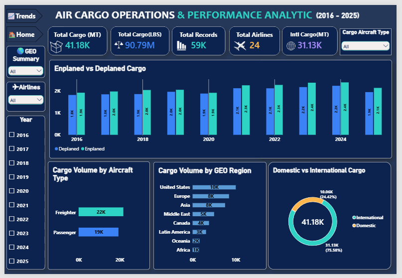
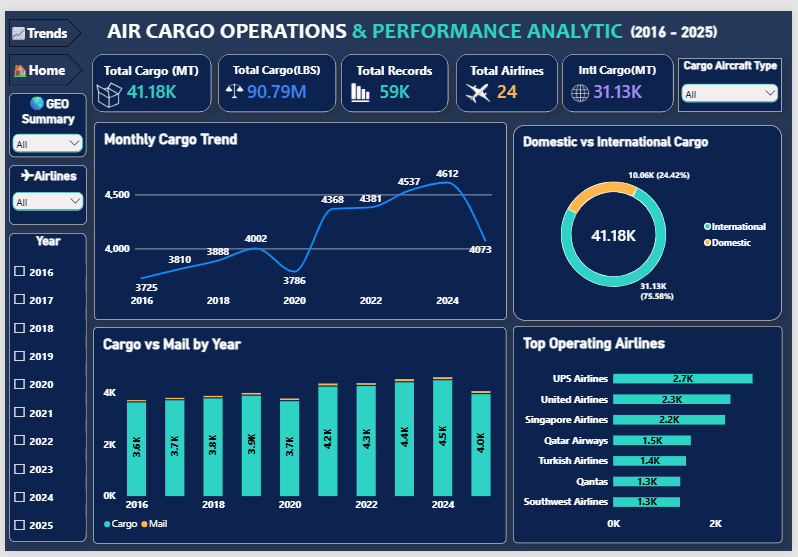

# ✈️ Air Cargo Operations & Performance Analytics

## 📌 Project Overview
This project focuses on analyzing air cargo operations and performance using SQL and Power BI. The objective is to understand cargo volume trends, airline performance, domestic and international cargo movements, and regional distribution.

## 🎯 Project Objectives
- Analyze overall air cargo volume.
- Identify top-performing airlines.
- Compare domestic and international cargo operations.
- Analyze cargo trends over time.
- Identify regional cargo distribution.
- Generate meaningful business insights through interactive dashboards.

## 🛠️ Tools & Technologies
- **SQL** – Data querying and analysis
- **Microsoft Power BI** – Data visualization and dashboard development
- **CSV** – Dataset storage and data source

## 📂 Project Structure
- `Dataset/` – Original air cargo dataset.
- `SQL/` – SQL queries used for analysis.
- `PowerBI/` – Power BI dashboard file.
- `Dashboard_Screenshots/` – Dashboard screenshots.

## 📊 Key Analysis Areas
- Total Cargo Volume (MT)
- International Cargo Volume
- Airline Performance
- Cargo Movement Trends
- Regional Cargo Distribution
- Domestic vs International Operations

## 📈 Dashboard
The Power BI dashboard provides interactive visualizations, KPIs, and filters to explore air cargo operational performance.

## 💡 Project Outcome
This project demonstrates practical skills in SQL querying, data analysis, business intelligence, and Power BI dashboard development.

## 📸 Dashboard Screenshots

### Home Dashboard

### Trend Analysis Dashboard

## 👨‍💻 Author
**S.K.KEERTHI**

Aspiring Data Analyst | SQL | Power BI | Python | Excel